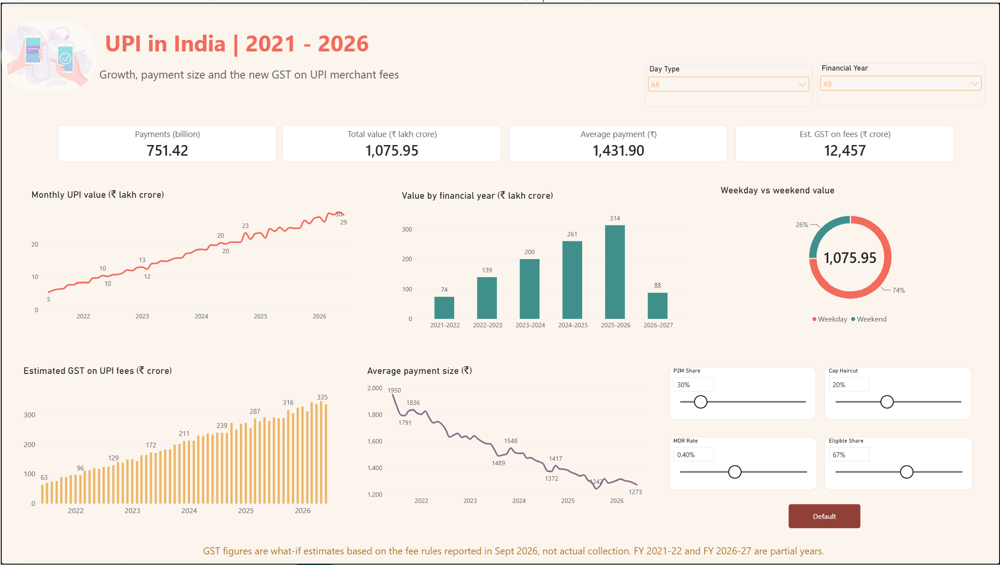

# UPI in India (2021–2026): Growth, Payment Size and GST on UPI Fees

An interactive **Power BI dashboard** built on five years of daily UPI data. It shows how UPI has grown, how the size of an average payment has changed, and gives a **what-if estimate of the GST on the new UPI merchant fee (MDR)**.



---

## Questions this project answers
1. How fast has UPI grown between June 2021 and June 2026?
2. How big is the average UPI payment, and is it changing?
3. What could the 18% GST on the new UPI merchant fee amount to?

## Key findings
- **751 billion payments** worth **₹1,076 lakh crore** were made over the five years.
- Monthly UPI value grew about **5×**, from ₹5.5 lakh crore (June 2021) to ₹28.9 lakh crore (June 2026).
- Yearly growth in value is slowing: about **+44%, +30% and +21%** in the last three full financial years.
- The **average payment fell** from about ₹1,950 to about ₹1,270. More small, everyday payments are being made.
- **Weekdays carry 74%** of the value and weekends 26%.
- Under the assumptions below, the estimated GST on the new fee is about **₹3,600 crore for FY 2025-26** (₹12,457 crore if the rule is applied to all five years of data). Because most UPI value is person-to-person and exempt, this is a very small share of total UPI value.

## What is on the dashboard
| Part | What it shows |
|---|---|
| 4 cards | Total payments, total value, average payment, estimated GST |
| Monthly UPI value (line) | Growth over time |
| Value by financial year (column) | Yearly totals (FY 2021-22 and FY 2026-27 are partial years) |
| Weekday vs weekend (donut) | Share of value by day type |
| Average payment size (line) | Average rupees per payment, by month |
| Estimated GST on UPI fees (column) | Monthly GST estimate from the what-if model |
| 4 sliders + Default button | Assumptions for the GST estimate |
| 2 dropdowns | Filter everything by financial year and weekday/weekend |

---

## The GST what-if model
**GST is not charged on a UPI payment itself.** As reported in September 2026, a fee (MDR) of **0.4%** applies from **15 October 2026** to eligible person-to-merchant payments above ₹2,000, capped at ₹300 per payment, with **18% GST charged on the fee**. Person-to-person transfers, payments up to ₹2,000 and some small merchants are exempt.

The dataset ends in June 2026, before the fee starts, so the dashboard cannot show real GST collected. Instead it applies the rule to past volumes using adjustable assumptions:

```
Est. GST = Total value × P2M share × Eligible share × MDR rate × (1 − Cap haircut) × GST rate
```

| Slider | Default | Basis |
|---|---|---|
| P2M Share | 30% | NPCI data: merchant (P2M) payments are about 29% of UPI value in FY 2025-26 |
| Eligible Share | 67% | NPCI statement: payments that will carry the fee are about two-thirds of merchant payment value |
| MDR Rate | 0.40% | Reported rule |
| Cap Haircut | 20% | **My own assumption** for the ₹300 cap, flat-fee payments and exemptions (no individual payment data) |
| GST rate | 18% (fixed) | Reported rule |

**Worked example (₹100 of UPI value):** ₹30 is merchant payments → ₹20.10 is eligible → fee 0.4% = ₹0.0804 → after the 20% haircut ₹0.0643 → GST 18% = ₹0.0116.

---

## Data
- **Source:** NPCI UPI statistics (daily volume and value), downloaded from the NPCI website on 08-10-2026.
- **Period:** 1 June 2021 – 30 June 2026 (1,856 daily rows)
- **Columns used:** Date, Volume (million payments), Value (₹ crore), plus date fields

### Cleaning and preparation
- Checked for missing values, duplicates, zero values and date gaps (none found)
- Checked every date-derived column (month, weekday, financial year) against the date
- Renamed columns; relabelled the file's **calendar** quarter and added **fiscal** month and quarter (April–March)
- Added **Average ticket (₹) = Value × 10 ÷ Volume** (value in crore, volume in million)
- Added `Year_Month`, `Month_Start` and sort columns
- Flagged **partial financial years** (FY 2021-22 starts in June; FY 2026-27 ends in June)
- Flagged one unusual-ticket day (3 April 2023) using a 30-day rolling check; kept it in the data

The cleaned file is in `data/UPI_Daily_Cleaned.csv`.

## Power BI model
- Tables: `UPI` (daily facts), `Calendar` (marked as date table, one-to-many on Date), and what-if parameter tables
- Key measures:
```dax
Total Value (Cr)  = SUM(UPI[Value_Crore])
Total Volume (Mn) = SUM(UPI[Volume_Million])
Avg Ticket (₹)    = DIVIDE([Total Value (Cr)] * 10, [Total Volume (Mn)])
Value (₹ Lakh Cr) = [Total Value (Cr)] / 100000

Eligible Value (Cr)  = [Total Value (Cr)] * [P2M Share Value] * [Eligible Share Value]
Est. MDR (Cr)        = [Eligible Value (Cr)] * [MDR Rate Value] * (1 - [Cap Haircut Value])
Est. GST on MDR (Cr) = [Est. MDR (Cr)] * [GST Rate Value]
```
- Techniques: Calendar table, what-if parameters, sort-by-column, continuous date axis, cross-filtering, custom theme, bookmark button to reset sliders

## Limitations
- The GST figures are **estimates**, not actual collections. The data ends before the fee starts.
- The dataset has no split between person-to-person and merchant payments, and no payment-size distribution, so the shares above are assumptions from published figures.
- GST-registered merchants can claim input tax credit on the GST, so it is not always a final cost.
- FY 2021-22 and FY 2026-27 are partial years and should not be compared with full years.
- Fee rules are as reported in September 2026 and may be refined. Check the official NPCI circular.

## Tools
Power BI Desktop · DAX · Power Query · Python (pandas) for data checks

## How to open
Download `UPI_Dashboard.pbix` and open it in Power BI Desktop (free). A PDF of the dashboard is also included.

## Sources
- NPCI UPI statistics (volume and value, P2P vs P2M): https://dataful.in/datasets/431/
- P2M share of volume and value, FY 2025-26: https://www.businesstoday.in/india/story/10-years-of-upi-transaction-value-surges-4000-fold-to-reach-rs314-lakh-crore-550975-2026-08-24
- GST on UPI MDR from 15 October 2026: https://www.knowyourgst.com/qa/upi-mdr-above-2000-to-attract-18-gst-from-october-15-what-merchants-need-to-know/8272/ and https://taxguru.in/?p=1082163


## Author
**Falha P**: [GitHub](https://github.com/falha8) · [LinkedIn](https://linkedin.com/in/falha-p)
